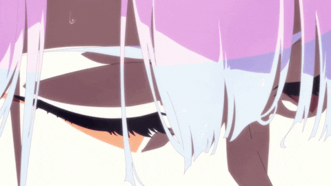

  

#

My name is Vinicius Nery, I'm 18 years old, and I plan to study Systems Analysis and Development at UNICAMP. I'm currently taking a course provided by Itaú Bank on DIO about Java with Artificial Intelligence.
 
#

<h3 align="left">Connect with me! </h3>

<h3 align="left">Estudando: </h3>

 
 

<picture align="center">
  <source media="(prefers-color-scheme: dark)" srcset="https://raw.githubusercontent.com/paulopontodev/paulopontodev/output/github-contribution-grid-snake-dark.svg">
  <source media="(prefers-color-scheme: light)" srcset="https://raw.githubusercontent.com/paulopontodev/paulopontodev/output/github-contribution-grid-snake-dark.svg">
  
</picture>
